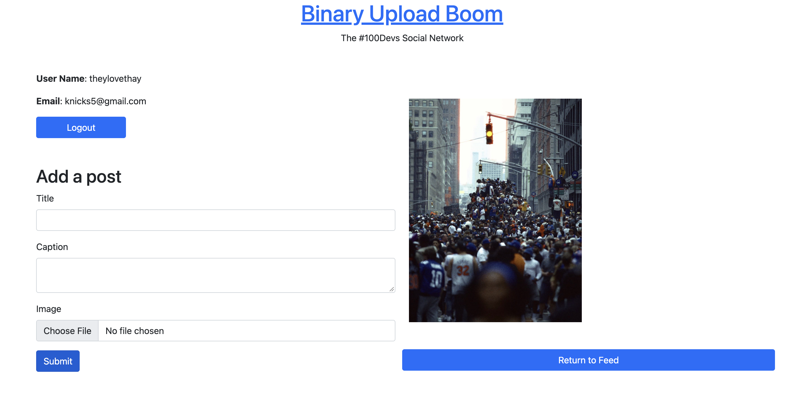

# Binary Upload Boom

A small photo-sharing social network — sign up, post a photo with a title and caption, and like or delete posts.



## What it does

- **User accounts** — sign up, log in, and log out with Passport local auth. Passwords are hashed with bcrypt, and signup input is validated.
- **Add a post** — title, caption, and a photo (`.jpg`, `.jpeg`, or `.png` only). The photo is uploaded with Multer and stored on Cloudinary.
- **Profile page** — shows your own posts and the add-a-post form.
- **Feed** — every user's posts, newest first.
- **Single post page** — the photo, title, caption, and like count, with a heart button to like the post.
- **Like a post** — adds 1 to the post's like count (`PUT /post/likePost/:id`).
- **Delete a post** — only the post's owner sees the delete button. Deleting removes the post from the database and the image from Cloudinary (`DELETE /post/deletePost/:id`).
- **Sessions** — login sessions are stored in MongoDB, and flash messages show login/signup errors.

## Tech stack

- Node.js + Express 4
- EJS templates
- MongoDB with Mongoose
- Passport (local auth) + express-session + connect-mongo
- Multer for file uploads, Cloudinary for image storage
- method-override (lets forms send PUT and DELETE), morgan, dotenv

## Getting started

1. Clone the repo and install dependencies:

   ```bash
   git clone https://github.com/tbrown320/binary-upload-boom.git
   cd binary-upload-boom
   npm install
   ```

2. Create a `.env` file in the `config` folder with your own values:

   ```
   PORT=2121
   DB_STRING=mongodb+srv://<username>:<password>@<cluster>/<database>
   CLOUD_NAME=<your Cloudinary cloud name>
   API_KEY=<your Cloudinary API key>
   API_SECRET=<your Cloudinary API secret>
   ```

   The server listens on `process.env.PORT` with no fallback, so `PORT` must be set (2121 is the example from the original setup notes — any free port works). `.env` is gitignored — never commit it.

3. Start the server:

   ```bash
   npm start
   ```

4. Open http://localhost:2121 (or whatever port you set in `PORT`), sign up, and add your first post.

## Project structure

```
server.js              - app entry point (listens on $PORT, no default)
Procfile               - web: node server.js (for deployment)
config/
  database.js          - MongoDB connection (reads DB_STRING)
  passport.js          - local signup / local login setup
controllers/
  auth.js              - login, signup, logout
  home.js              - landing page
  posts.js             - profile, feed, single post, create/like/delete post
middleware/
  auth.js              - ensureAuth / ensureGuest route guards
  cloudinary.js        - Cloudinary config (reads CLOUD_NAME, API_KEY, API_SECRET)
  multer.js            - file upload filter (jpg, jpeg, png only)
models/
  Post.js              - post model (title, image, cloudinaryId, caption, likes, user)
  User.js              - user model
routes/
  main.js              - home, profile, feed, login, signup, logout
  posts.js             - single post, create post, like post, delete post
views/
  index.ejs            - landing page
  login.ejs            - login form
  signup.ejs           - signup form
  profile.ejs          - your posts + add-a-post form
  feed.ejs             - all posts, newest first
  post.ejs             - single post (like, delete)
  todos.ejs            - unused leftover from the template (no route serves it)
  partials/            - shared header and footer
public/
  css/style.css        - styling
  imgs/                - favicon
```

---

Thay Brown — thaybrown22@gmail.com · https://thaythecoder.netlify.app · https://github.com/tbrown320 · https://www.linkedin.com/in/thaybrown
